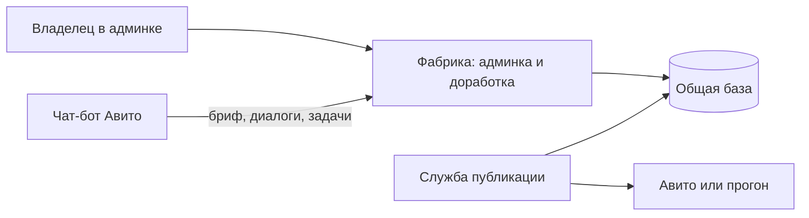

# Парная

Фабрика объявлений для публикатора Авито. Хозяин продаёт бани, бани-бочки, купели, печи, банные чаны, сауны и смежные услуги. Чат с покупателем живёт в отдельном боте. Здесь готовят текст, человек явно согласовывает карточку, и только после этого служба публикации говорит с API Авито.

По умолчанию наружу ничего не уходит: тексты собирает шаблон из брифа, публикация идёт в прогоне.

## Как устроено

Два процесса, одна база, между ними очередь задач в этой базе. Бот не знает API Авито. Служба публикации не знает про чаты.



Очередь — таблица `tasks`.

| Тип | Кто выполняет | Что делает |
| --- | --- | --- |
| `create_listing` | служба публикации | Публикует объявление, но только если статус ровно `approved` |
| `fetch_avito_metrics` | служба публикации | Снимает просмотры, избранное и запросы контакта |
| `rework_listing` | фабрика | Собирает новую версию и снова ставит её на согласование |

Статусы объявления:

`draft` → `validated` → `pending_approval` → `approved` → `publishing` → `published`

В сторону уходят `rejected` и `needs_rework`. Пропустить согласование нельзя: и форма, и воркер отказываются публиковать всё, что не `approved`. В журнале `approval_audits` лежит, кто и когда нажал.

## Что уже работает

- Бриф в админке: категория из банного списка, тип товара, для кого, тон (деловой / дружелюбный / экспертный), цена, регион, особенности, бюджет продвижения. У каждой категории свои поля и обязательные из них.
- Черновик: заголовок до 50 символов, 2–3 альтернативы, описание и характеристики. Берутся только заполненные факты. Бюджет продвижения в текст не попадает.
- Генератор за интерфейсом. Без `OPENAI_API_KEY` работает детерминированный шаблон. С ключом заголовки и описание может предложить совместимый с OpenAI endpoint, но строка попадает в карточку только если каждое слово и число уже есть в брифе. Характеристики всегда собираются из брифа, не из ответа модели.
- Проверка: телефоны, почта, ссылки, рекламные шаблоны, длина, обязательные поля категории, точный дубль и похожий заголовок. Результат виден согласующему. Ошибки блокируют отправку, замечания (нет фото, только рендер) — нет, но они на виду.
- Согласование: одобрить, отклонить или вернуть с комментарием. Возврат сразу собирает новую версию, её снова нужно одобрить.
- Фото: карточка с пометкой «живое» или «синтетический рендер». Очистка и кадрирование — заглушка, пиксели не трогаются.
- Служба публикации читает очередь. По умолчанию клиент `dry_run` пишет учебный номер и не вызывает Авито. Боевой клиент — каркас: токен описан как предположение, публикация и статистика сознательно бросают `NotImplementedError`.
- Метрики: снимки просмотров, избранного («сердечки»), запросов контакта и числа диалогов бота. Правило: мало просмотров — новая версия с другим заголовком и просьбой сменить главное фото; много просмотров и почти нет контактов — пересобрать описание. Новая версия снова идёт через согласование. Старая опубликованная не снимается.
- Бот снаружи: `POST /api/bot/briefs`, `POST /api/bot/tasks`, `POST /api/bot/dialogs`.

## Что пока заглушка

- Боевая публикация и боевая статистика Авито. Точные методы создания объявления и съёма статистики не выдуманы — их нужно сверить с кабинетом (часто это автозагрузка, а не простой REST «создать товар»).
- Запрос токена в `RealAvitoClient.request_token` написан по открытой схеме OAuth client credentials (`POST {AVITO_TOKEN_URL}`, форма `grant_type=client_credentials`). Это предположение, перед боем его надо сверить. Сам `publish()` токен не запрашивает.
- Лимит заголовка 50 символов и потолок описания 3000 — рабочие ограничения фабрики. У Авито лимит описания зависит от категории, перед боем его нужно подтвердить.
- Обработка фото не режет и не чистит кадр.
- Цифры просмотров в интерфейсе — учебные сценарии `low_views`, `high_views_low_contacts`, `healthy`. Диалоги бота при этом пишутся по-настоящему.
- Избранное сохраняется и показывается, в правило слабых объявлений пока не входит.
- Нет входа и ролей. Имя согласующего — поле «кто за столом», оно уходит в журнал.
- Нет снятия старой карточки с Авито, когда выходит новая версия.

## Как запустить

Нужен Python 3.11+.

```bash
python -m venv .venv
source .venv/bin/activate
pip install -r requirements.txt
cp .env.example .env
python -m app.dev
```

Админка: <http://127.0.0.1:8741>

`python -m app.dev` поднимает сайт и службу публикации вместе. По отдельности:

```bash
python -m app.main      # админка и цикл доработки
python -m app.worker    # только публикация и съём метрик
```

Проверки:

```bash
pytest
```

Два контейнера и общий том:

```bash
docker compose up --build
```

Секреты только в `.env`. В репозиторий кладётся `.env.example`.

Дальше по экрану: «Новый бриф» → пример «Баня-бочка 4 м» → «Собрать черновик» → при желании карточки фото → «Отправить на согласование» → указать имя → «Согласовать». Через секунду статус станет «Опубликовано в прогоне». На «Метриках» можно снять сценарий «Мало просмотров» и нажать «Проверить правило»: появится новая версия, старая останется опубликованной в прогоне.

Если служба публикации не запущена, на странице «Очередь» есть кнопка одного шага.

## Контракт для чат-бота

Создать бриф и черновик, не публикуя:

```bash
curl -s -X POST http://127.0.0.1:8741/api/bot/briefs \
  -H 'Content-Type: application/json' \
  -d '{
    "category": "stove",
    "product_type": "Печь дровяная 18 кВт",
    "target_buyer": "Частный покупатель на участок",
    "tone": "expert",
    "price": 42000,
    "region": "Санкт-Петербург",
    "key_features": ["сталь 4 мм", "выносная топка"],
    "extra": {"fuel": "дрова", "power_kw": "18"}
  }'
```

Поставить задачу. Если объявление не согласовано, воркер завершит её ошибкой и клиент Авито не вызовет:

```bash
curl -s -X POST http://127.0.0.1:8741/api/bot/tasks \
  -H 'Content-Type: application/json' \
  -d '{"type":"create_listing","payload":{"listing_id":1},"idempotency_key":"bot-1"}'
```

Записать диалог. Число разных `external_dialog_id` попадёт в следующий снимок метрик:

```bash
curl -s -X POST http://127.0.0.1:8741/api/bot/dialogs \
  -H 'Content-Type: application/json' \
  -d '{"listing_id":1,"external_dialog_id":"dlg-1","event_type":"message","payload":{"text":"Когда можете привезти?"}}'
```

Статус задачи: `GET /api/tasks/{id}`. Карточка: `GET /api/listings/{id}`. Живость: `GET /api/health`.

Типы задач от бота: `create_listing`, `fetch_avito_metrics`, `rework_listing`. В `payload` нужен `listing_id`. Для учебного съёма метрик добавьте `"scenario": "low_views" | "high_views_low_contacts" | "healthy"`.

## Дорожная карта

1. Сверить метод публикации с кабинетом Авито и включить боевой клиент. Скорее всего это автозагрузка, не угаданный REST.
2. Снять реальные просмотры, избранное и запросы контакта тем же клиентом.
3. Подтянуть диалоги боевого бота в ту же таблицу `dialog_events`.
4. Настоящая обработка фото: кадр, вес, отдельное хранение рендеров. Синтетика остаётся помеченной.
5. Вход согласующего и роли вместо свободного имени.
6. Продвижение отдельной задачей из бюджета брифа, после согласования.
7. Снятие или обновление старой карточки, когда новая версия опубликована.
8. Postgres вместо SQLite, когда очередь станут читать больше двух процессов.
9. Учитывать избранное в правиле слабых объявлений.
